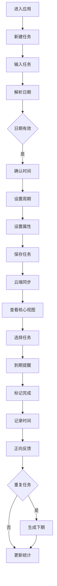

## 业务理解

本系统是一款面向个人用户、以日期和时间为核心的待办事项管理应用。用户可规划任务、设置重复周期与分类属性，并通过多维视图、提醒和完成反馈推进执行。系统结合云端同步与数据统计，帮助用户形成从规划、执行到复盘的完整闭环，首版优先覆盖日期设置、完成标记和核心视图。

## 业务流程

## 异常/边界

- 自然语言日期无法识别时，提示用户手动选择日期和时间。
- 截止时间早于起始时间时，不允许保存并提示修正。
- 任务逾期未完成时，在相关视图中红色高亮并置顶。
- 云端同步失败时，保留本地变更并提示稍后重试。
- 重复任务跨月或遇到无对应日期时，按既定周期规则调整。