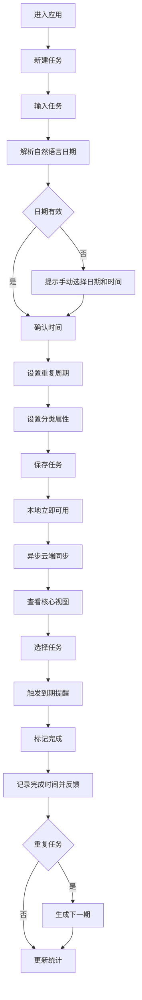

# 日期驱动待办事项管理应用 PRD

## 1. 产品概述

### 1.1 产品定位

面向个人用户的日期驱动型待办事项管理应用。用户可以快速创建任务，设置日期、起止时间、重复周期和组织属性，在今日、未来、逾期、已完成及日历视图中执行任务，并通过提醒、完成反馈、统计和多端同步形成规划、执行、复盘闭环。

### 1.2 目标用户

- 需要管理个人工作、学习、生活事项的用户。
- 需要按日期和时间安排任务，并处理周期性任务的用户。
- 需要在多个设备之间保持任务一致性的用户。

### 1.3 产品目标

- G1：让用户能在不超过两步的主要操作内创建带日期的任务。
- G2：让用户能清楚区分今日、未来、逾期和已完成任务，并快速完成任务。
- G3：支持从单次任务到重复任务、提醒、统计和复盘的完整闭环。
- G4：保证本地操作可用，并通过云端同步在多设备间保持一致。

### 1.4 成功指标

- 快速创建流程从输入到保存不超过两次主要交互；自然语言日期可直接转为结构化日期和时间。
- 完成标记为单次点击或等价操作，并记录完成时间。
- 逾期未完成任务在相关视图中始终红色高亮且排在非逾期任务之前。
- 同一账户在两台设备上的任务变更最终一致；同步失败不丢失本地变更。

## 2. 范围与版本

### 2.1 MVP 范围

- 任务增删改查。
- 年、月、日截止日期及可选起始时间、结束时间。
- 自然语言日期解析和解析失败后的手动选择。
- 标记完成或未完成，完成时间记录和正向反馈。
- 今日待办、未来任务、逾期任务、已完成和日历视图。
- 每日、每周、每月和自定义重复周期。
- 本地优先保存和基础云端同步。

### 2.2 后续版本范围

- 清单分类、标签、优先级和子任务。
- 到期提醒及通知权限管理。
- 完成率、按日完成热力图等统计。
- 更丰富的冲突解决、设备管理和同步诊断。

### 2.3 不在本 PRD 范围内

- 团队协作、共享清单、评论和权限角色。
- 第三方日历双向同步。
- 复杂项目管理、甘特图和工时计费。
- 具体身份认证供应商；同步功能假设已有稳定的账户标识和会话能力。

### 2.4 当前仓库基线

当前仓库仅包含 `prd.md` 和 `doc/FLOW.md`，没有运行时代码、依赖清单或测试框架。后续实现需要由首个编码特性建立技术栈和测试基础；本 PRD 不预设语言或框架。

## 3. 核心业务流程

## 4. 功能需求

### 4.1 任务生命周期与日期输入 F1

- 每条任务必须有非空标题、稳定唯一 ID、创建时间和更新时间。
- 任务必须保存截止日期的年、月、日；起始时间和结束时间为可选，均使用用户本地时区。
- 当同时存在起始时间和结束时间时，结束时间不得早于起始时间；校验失败时禁止保存并显示可操作的修正提示。
- 快速输入支持中文自然语言日期和时间，例如 `明天下午3点`；解析结果必须在保存前可见且可编辑。
- 无法识别自然语言日期时，必须提示用户通过日期和时间选择器手动输入，不能静默保存为错误日期。
- 任务支持创建、读取、更新和删除；删除操作需有明确确认或可撤销机制，避免误删。

### 4.2 完成状态与重复任务 F2

- 任务状态至少包括未完成和已完成；切换为已完成时记录完成时间，切换回未完成时清除当前完成时间。
- 重复周期支持每日、每周、每月和自定义；每周可指定星期，自定义至少支持间隔数值和周期单位。
- 完成重复任务后，当前实例保持已完成，并生成下一期未完成实例，继承标题、属性和重复规则。
- 月度重复遇到目标月份不存在对应日期时，使用该月最后一天；后续月份继续依据原始日期锚点计算。
- 完成操作必须提供即时、非阻塞的正向反馈，并且重复触发不会生成重复实例。

### 4.3 核心视图与筛选 F3

- 提供今日待办、未来任务、逾期任务、已完成和日历五种视图。
- 今日视图按用户本地日期筛选；未来视图只包含今天之后的未完成任务；已完成视图按完成时间筛选。
- 逾期定义为未完成且当前时间晚于任务结束时间；没有具体时间的任务按本地日期结束时刻判断。
- 逾期任务在列表中使用红色高亮，并按截止时间升序置于其他任务之前。
- 日历视图按截止日期展示任务，并允许从日期单元格进入任务详情或创建任务。
- 各视图的筛选和任务完成操作不会改变任务的原始日期或重复规则。

### 4.4 清单、标签、优先级与子任务 F4

- 用户可以创建、重命名和删除清单，并将任务归入一个清单；删除清单时必须明确任务保留策略。
- 任务可以拥有多个标签，支持按标签筛选和移除标签。
- 优先级至少提供四级，并可在列表中稳定排序和筛选。
- 任务可以拥有多层或至少一层子任务；父任务完成状态不得在子任务未完成时被静默覆盖。
- 组织属性为可选项，不得阻塞两步以内的基础任务创建。

### 4.5 到期提醒与数据统计 F5

- 用户可以为任务启用或关闭提醒；有具体时间的任务以结束时间为默认提醒时刻，无具体时间的任务以截止日当地 09:00 为默认提醒时刻。
- 已完成任务不再触发未完成提醒；提醒失败或权限被拒绝时，在应用内显示待处理状态。
- 统计支持按时间范围计算完成率，公式为已完成任务实例数除以应完成任务实例数，取消项不计入分母。
- 提供按用户本地日期聚合的完成热力图；重复任务按实际生成的任务实例计数。

### 4.6 多端云端同步 F6

- 任务写入采用本地优先策略：保存和状态切换立即反映在当前设备，并异步进入同步队列。
- 同一账户在多个设备登录后，任务增删改、完成状态、重复规则和组织属性最终一致。
- 同步失败时保留本地变更、显示稍后重试提示，并支持手动或自动重试；重试不得产生重复任务。
- 同一记录发生冲突时使用服务器可比较的更新时间和稳定设备标识进行确定性处理，结果在所有设备一致。
- 同步队列和错误状态可被诊断，网络恢复后能继续处理未同步变更。

## 5. 业务规则与异常边界

- B1：所有日期和时间以用户设置的本地时区解释和展示；夏令时导致的无效时间必须提示修正。
- B2：自然语言解析失败必须回退到手动日期和时间选择，不得猜测并保存。
- B3：结束时间早于起始时间时禁止保存，并保留用户已输入内容以便修正。
- B4：逾期任务必须红色高亮并置顶；完成后立即从逾期集合移除。
- B5：重复任务跨月或目标日期不存在时按月末规则调整；原始日期锚点不能被覆盖。
- B6：云端不可用时本地任务仍可创建、编辑、完成和查看，恢复后再同步。
- B7：日期为空的任务不属于今日、未来或逾期视图，直到用户补充日期；MVP 创建流程默认要求截止日期。

## 6. 交互与体验约束

- U1：从任一主要任务列表打开快速创建并保存，主要交互不超过两步；日期解析确认以内联控件完成。
- U2：完成、取消完成和切换视图应为单次点击或等价键盘操作。
- U3：错误提示必须指出具体字段和修正动作，不能只显示通用失败信息。
- U4：颜色不能作为唯一状态信号；逾期红色高亮同时配合文本或图标语义。
- U5：在移动端和桌面端均保持可读、可键盘操作和不遮挡任务内容。

## 7. 数据模型与接口约束

- D1：Task 至少包含 `id`、`title`、`dueDate`、`startAt`、`endAt`、`timezone`、`status`、`completedAt`、`recurrence`、`listId`、`tags`、`priority`、`parentId`、`createdAt`、`updatedAt`。
- D2：重复规则使用结构化字段保存，不依赖展示文本；生成实例必须保留来源任务或规则 ID。
- D3：完成时间、更新时间和同步时间使用可比较的标准时间格式保存，展示时转换为用户时区。
- D4：日期解析器返回结构化日期、时间、重复信息和解析状态；调用方可以区分成功、部分成功和失败。

## 8. 非功能需求

- N1：本地读取和状态切换在常规设备上应即时反馈；同步和提醒调度不得阻塞主交互。
- N2：核心领域逻辑必须可在无网络环境下测试和运行。
- N3：数据传输和云端存储应采用平台认可的加密机制；日志不得记录任务标题等敏感内容。
- N4：删除、重复生成和同步重试操作应具备幂等性。

## 9. 发布验收

- A1：MVP 必须覆盖 F1、F2、F3 及 B1-B7 中与其相关的规则。
- A2：后续版本完成 F4、F5、F6 后，才能宣称覆盖完整规划、执行、提醒、统计和多端同步闭环。
- A3：每个功能特性都必须有自动化领域测试；当前仓库无测试框架，首个实现特性需同时建立可重复运行的测试命令。

## 10. 建议实现边界

由于当前仓库是文档-only 基线，编码代理可在不改变本 PRD 的前提下选择技术栈。建议按领域、应用服务、持久化和界面查询分层，先建立可测试的任务模型与日期规则，再接入界面、提醒和同步。
